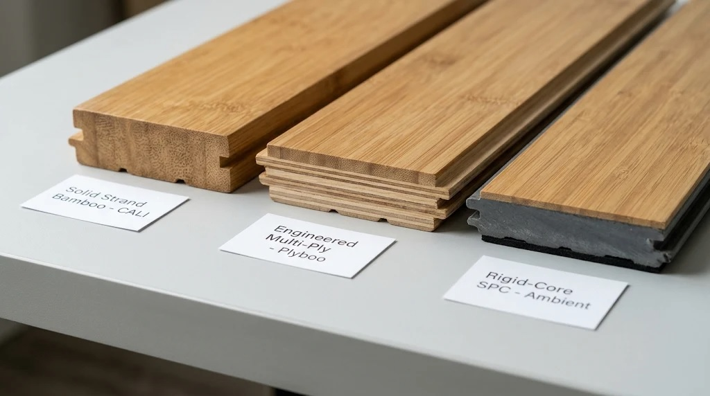
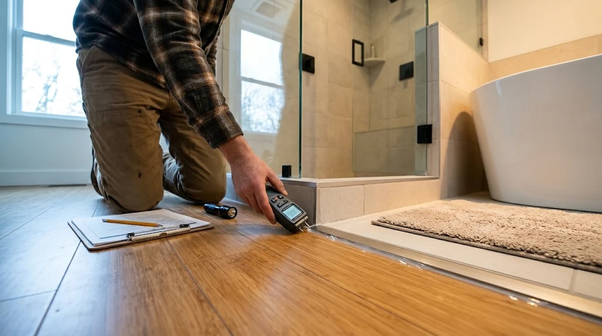
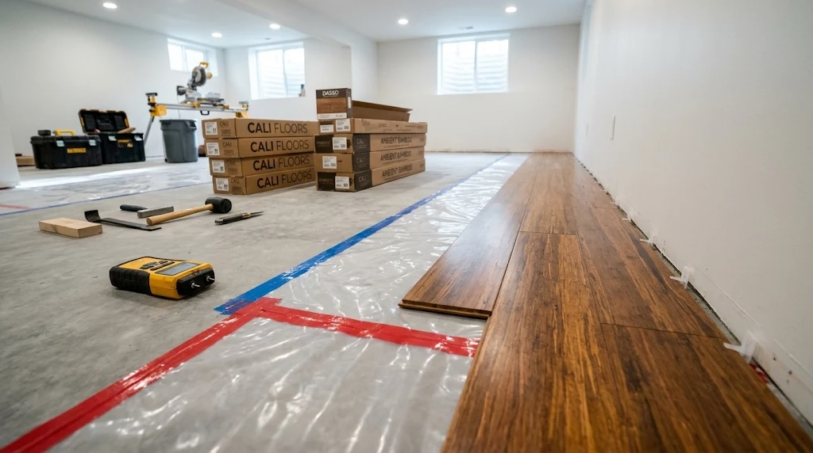

Yes, bamboo flooring can go in a basement or a half-bath, but standard solid bamboo does not belong in a full bathroom with a shower or tub, and it should never sit directly over a damp concrete slab. Whether bamboo survives below grade or near plumbing depends on two things: the core construction inside the plank and how strictly you manage moisture in the room.

Many homeowners assume that because bamboo grows in wet tropical climates, finished bamboo floors shrug off puddles and steam. Once harvested, kiln-dried, and milled into planks, bamboo behaves much like dense domestic hardwood. Put the wrong plank in a humid space, and you will see cupped edges, creaking joints, or warped seams within a single season. Pick the right engineered or rigid-core construction and prep the subfloor properly, though, and bamboo holds up reliably in finished basements and guest powder rooms.

## Why Bamboo Reacts to Moisture Unlike Vinyl or Tile

Bamboo is a grass, not a timber tree, yet its cellular structure is hygroscopic. That means dried bamboo planks constantly absorb water vapor when the air turns damp and release it when indoor air dries out. Most finished bamboo flooring leaves the factory dried to roughly 8 percent moisture content so it matches typical conditioned living spaces.

As indoor relative humidity rises, individual planks swell across their width. If the bottom of a plank absorbs moisture from a concrete slab faster than the finished top face, the edges curl upward into a concave shape known as cupping. Leave standing water on top of the planks long enough to seep through the bevels, and the edges swell permanently, causing the finish to flake or the veneer layers to separate.

Hardness ratings often confuse buyers on this point. High-density strand-woven bamboo—such as CALI Floors Fossilized planks, which test past 5,000 on the Janka hardness scale—resists pet claws and dropped cookware better than red oak or hickory. Extreme density slows down initial water absorption compared to softer horizontal or vertical bamboo, but it does not make the floor waterproof. In fact, when dense strand-woven bamboo does absorb excess water, it expands with tremendous lateral force capable of buckling a floor tight against the baseboards.

## Solid, Engineered, and Rigid-Core Bamboo Compared

Not all bamboo planks share the same moisture tolerance. Before buying material for a damp zone, look past the stain color and inspect the cross-section of the plank.

### Solid Bamboo Planks

Solid bamboo planks—whether classic horizontal, vertical, or compressed strand-woven—are milled from bamboo all the way through. Because every millimeter of thickness reacts to ambient humidity, solid planks move the most as seasons shift. Ambient Bamboo notes that floating solid bamboo can shrink noticeably if indoor relative humidity drops below 35 percent, and installers restrict long continuous runs in climates with wide seasonal swings. Solid bamboo belongs above grade in living rooms, bedrooms, and hallways. Keep it out of basements and full bathrooms.

### Engineered Multi-Ply Bamboo

Engineered bamboo bonds a real bamboo top wear layer—often 2 millimeters or thicker on mid- to upper-tier lines—onto a cross-layered wood core, usually eucalyptus or birch plywood. Cross-ply construction counteracts natural grain movement, giving engineered planks far better dimensional stability than solid boards. Look specifically for multi-ply plywood cores rather than high-density fiberboard (HDF) cores, because HDF swells rapidly if water reaches the seam. Brands including CALI Floors, Ambient Bamboo, and Plyboo build engineered lines suited for below-grade basements once concrete moisture requirements and vapor barriers are in place.

### Rigid-Core Waterproof Bamboo

Rigid-core bamboo pairs a thin real bamboo top layer with a dense limestone-composite or stone-plastic composite (SPC) core and an attached acoustic foam pad such as IXPE. Ambient's Rigid Core Strand Bamboo and CALI's GeoWood collection (which uses a limestone GeoCore under roughly a 1.2-millimeter real veneer) follow this hybrid architecture. Because the mineral core cannot absorb moisture or rot, the plank stays flat even when subfloor humidity shifts. That makes rigid-core bamboo the safest bamboo option for basements, kitchens, and powder rooms. Keep one limitation in mind: the core is waterproof, yet the top surface is still organic bamboo sealed under aluminum-oxide urethane. Long-term standing puddles or trapped water around a shower curb can still stain or damage that top veneer.

## Bamboo Flooring in Bathrooms: Half-Bath vs. Full Bath

Lumping all bathrooms into a single category leads to expensive flooring mistakes. A half-bath and a family shower room subject a floor to completely different moisture loads.

### Powder Rooms Handle Bamboo Well

A downstairs half-bath has only a sink and a toilet. There is no daily shower steam pushing relative humidity past 80 percent, and no wet bathers stepping out of a tub onto bare planks. Engineered multi-ply bamboo or rigid-core bamboo performs well in a powder room as long as you place an absorbent rug beneath the sink, wipe splashes promptly, and keep an eye on the toilet base for slow supply-line or wax-ring leaks.

### Full Bathrooms Carry Real Risk

Full bathrooms attack bamboo from above and below. Hot showers spike airborne moisture in minutes, and condensation settles directly into the micro-bevels between planks. Even with a strong exhaust fan running during and after every shower, wet bath mats left sitting on bamboo trap moisture against the finish for hours. Over months of daily baths, water works past the top coating, darkening seams and causing edge swelling around the tub apron. Rigid-core waterproof bamboo can survive in a light-use guest full bath if you seal the tub perimeter with flexible silicone where permitted and dry puddles fast, but in a busy kids' bathroom or master shower suite, organic bamboo remains a gamble.

### Warranty Fine Print Matters

Reading manufacturer warranties quickly separates marketing language from real risk. Both CALI Floors and Ambient Bamboo specify maintaining steady indoor relative humidity—typically 35 to 55 percent under National Wood Flooring Association guidelines, with specific product guides ranging from 30 to 55 percent or 35 to 65 percent—alongside indoor temperatures between 60 and 80 degrees Fahrenheit. Across major brands including CALI, Ambient, and Plyboo, residential warranties explicitly exclude damage from standing water, plumbing leaks, wet mopping, steam mops, and rooms with extreme humidity swings. If a toilet overflows overnight or shower runoff warps the planks near a tub, the repair comes out of your pocket.

## Installing Bamboo Flooring in a Below-Grade Basement

Basements present the opposite moisture challenge from bathrooms. Instead of surface splashes, the threat comes upward through porous concrete and outward from cool foundation walls. Even a basement that looks bone-dry to the naked eye can push steady water vapor into your floor year-round.

### Concrete Moisture Tests Come First

Never judge a concrete slab by its age or surface appearance. A slab poured months ago without an under-slab vapor retarder can still hold dangerous internal moisture. Before opening a single carton of bamboo, test the concrete using one of two industry-recognized standards backed by NWFA guidelines:

- **ASTM F2170 In-Slab Relative Humidity Test:** Technicians drill small holes to 40 percent of the slab depth and insert calibrated probes. Internal slab relative humidity must measure 75 percent or lower at every test spot before installing engineered bamboo.
- **ASTM F1869 Calcium Chloride Test:** Sealed dishes sit on the concrete surface for 60 to 72 hours to measure the moisture vapor emission rate. Most manufacturers cap acceptable emissions at 3.0 pounds per 1,000 square feet over 24 hours.

If you are installing over a raised wood subfloor in a basement or above a crawl space, verify with a pin moisture meter that the wood subfloor reads 12 percent moisture content or lower before laying planks. Make sure the home's HVAC system has been running at normal living conditions for at least 48 hours prior to testing so your numbers reflect real occupancy.

### Vapor Barriers and Moisture Adhesives

Even when a basement slab passes moisture testing, never skip a dedicated moisture barrier. For floating installations of engineered click-lock bamboo, lay down a minimum 6-mil polyethylene plastic sheet across the entire concrete surface, overlapping all seams by at least 6 inches and sealing them tight with moisture-resistant tape. Many rigid-core bamboo planks include a pre-attached IXPE pad, yet pairing them with a 6-mil poly sheet over concrete adds cheap insurance against seasonal vapor spikes.

If you prefer gluing engineered bamboo directly to concrete, standard flooring glue only handles minor vapor levels around 3 pounds. Step up to a dedicated moisture-mitigating urethane adhesive—brands such as Plyboo and Ambient commonly reference products like Bostik Ultra-Set Single Step or Bostik Vapor Lock—applied with the manufacturer's specified trowel notch so the adhesive creates a continuous waterproof membrane.

### Expansion Gaps and Basement Humidity

Leave at least a 1/2-inch expansion gap between the bamboo flooring and every wall, support column, pipe, and fixed cabinet. Undercut door jambs so planks can expand freely underneath without pinching, and never anchor heavy built-ins or permanent shelves through a floating bamboo floor.

Once the floor is down, keep a reliable digital hygrometer on the basement wall and run a standalone dehumidifier throughout humid summer months. Holding the room steadily between 35 and 55 percent relative humidity prevents the seasonal swelling and winter gapping that ruin below-grade wood floors.

## Daily Care Habits for Damp-Zone Bamboo

Bamboo flooring typically costs between $3 and $8 per square foot for materials, plus another $2 to $5 per square foot for professional installation. Protecting that budget takes simple, consistent habits:

- **Blot spills immediately:** Press a dry microfiber towel onto water drops instead of wiping sideways, which pushes moisture into plank joints.
- **Ditch steam and wet mops:** High-heat steam drives vapor straight through polyurethane wear layers, guaranteeing cupping and delamination. Use a dry microfiber dust mop daily and a lightly misted pH-neutral hardwood cleaner—such as Bona—when deeper cleaning is needed.
- **Choose breathable rugs:** Skip solid rubber-backed or plastic-backed bath mats that trap vapor against the finish. Pick washable cotton mats or natural-weave rugs paired with breathable, non-staining rug pads, and lift damp bath mats off the floor right after use.
- **Check plumbing seasonally:** Inspect under-sink traps, toilet supply valves, and basement dehumidifier drain lines every few months to catch tiny drips before they soak beneath the planks.

## When to Choose Tile or Vinyl Instead

Bamboo brings real natural grain and warmth that synthetic planks struggle to copy, and rigid-core or engineered strand bamboo earns its spot in dry finished basements and guest powder rooms. Still, some rooms simply call for a non-organic material. If your basement has any history of hydrostatic groundwater seepage, spring thaw leaks, or sump pump backups, skip bamboo altogether and install porcelain tile or 100 percent waterproof luxury vinyl plank (LVP). The same rule applies to a heavily used full bathroom where kids splash water out of the tub every evening. Saving bamboo for rooms where you can reliably control humidity and wipe up water quickly keeps the floor flat, tight, and sharp for decades.