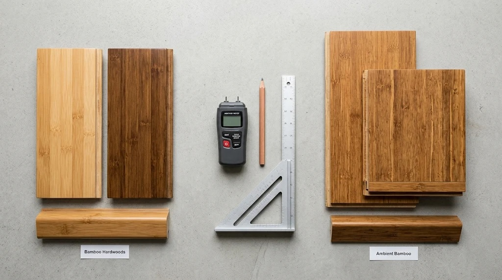
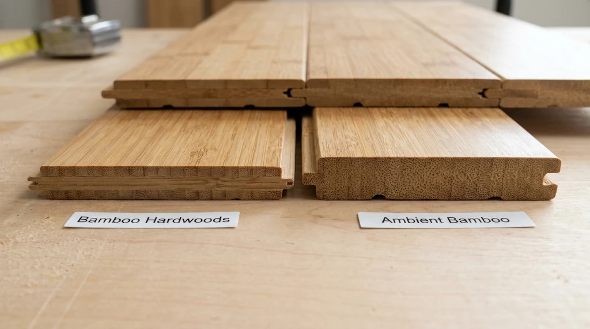
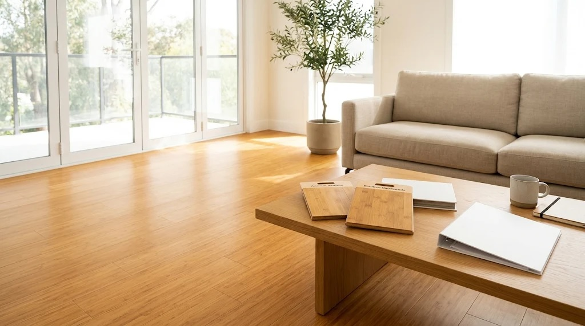

Ambient Bamboo Floors generally delivers better value per square foot, tighter batch-to-batch color consistency, and faster direct support than Bamboo Hardwoods, especially on residential orders above 800 square feet. Bamboo Hardwoods, which was founded in Seattle in 1996 and now operates commercially as BHW Floors, still makes sense for homeowners who prefer buying through a local flooring showroom that handles on-site measurement, subfloor prep, and bundled installation.

Both names carry real history in the North American bamboo flooring market, and both sell strand-woven planks hard enough for busy households with dogs and heavy furniture. Once you move past showroom photos and look at actual carton pricing, milling thickness, lot control, and warranty claims, the two companies operate on completely different playbooks. Understanding how those playbooks affect your budget and installation day will save you from expensive surprises once pallets hit your driveway.

## How Their Business Models Shape Your Experience

Most differences between these two brands trace back to how a carton gets from the factory to your subfloor.

Bamboo Hardwoods started in Seattle in 1996 as a dedicated bamboo supplier before evolving into BHW Floors, a broader multi-category distributor offering engineered bamboo alongside oak hardwood, waterproof laminate, and rigid-core vinyl. BHW Floors sells through regional distributors, brick-and-mortar flooring dealers, and authorized online retailers rather than shipping direct to homeowners. Every step in that chain adds local overhead, though it also gives you access to a physical showroom where you can hold full boards and book a vetted installer under one roof.

Ambient Bamboo Floors—officially Ambient Building Products, founded in Jessup, Maryland in 2005—runs a factory-direct model. Instead of splitting inventory across hundreds of independent dealers, Ambient stocks its strand-woven bamboo and eucalyptus lines centrally and sells directly to homeowners, builders, and contractors online. Cutting out the wholesale middleman gives Ambient tighter control over retail pricing, lot allocation, and technical phone support.

## Pricing Breakdown and Total Landed Cost

Comparing sticker prices on a product page rarely tells the whole story with bamboo flooring. Freight charges, matching stair noses, adhesives, and dealer markups can easily swing a 1,000-square-foot project by $1,500 or more.

### Plank Cost Per Square Foot

Ambient publishes transparent factory-direct pricing across its catalog. Core strand-woven bamboo lines generally fall between $3.99 per square foot during promotions and $7.07 per square foot for premium wide-plank or hand-scraped engineered profiles. Solid tongue-and-groove strand-woven planks typically land between $4.74 and $6.48 per square foot—for example, Ambient's 9/16-inch Natural Wide Plank Solid T&G sells around $6.01 per square foot. Engineered click-lock strand-woven planks sit in a similar range around $5.19 to $6.87 per square foot, while rigid-core click-lock options like Cocoa Carbonized start near $4.54 per square foot.

Because Bamboo Hardwoods sells through dealers as BHW Floors, pricing varies noticeably depending on whether you buy from a high-volume online reseller or a neighborhood showroom. Online dealers commonly list BHW's popular Arcade engineered strand-woven bamboo collection around $5.29 per square foot. Step into a brick-and-mortar flooring store, and quotes for BHW collections like Arcade, Anji, or Manor II frequently climb into the $5.50 to $7.25 per square foot band once local retail margins are baked in. On pure material price for equivalent thickness, Ambient almost always undercuts showroom quotes for Bamboo Hardwoods, while matching or beating discount online BHW listings.

### Freight, Samples, and Trim

Shipping and accessories are where budget gaps widen fast. Ambient ships up to five 4-inch flooring samples for free, with larger 8-inch boards available for $2 and 16-inch boards for $6 so you can judge grain variation before committing. Most flooring orders arrive in three to seven business days, and Ambient waives freight entirely on orders of 800 square feet or more. That free-freight threshold alone saves roughly $250 to $450 on an average main-floor remodel.

BHW Floors also supplies free samples through its website and local dealer displays, which makes side-by-side home testing easy. Freight rules, however, depend entirely on the selling dealer. Local stores often fold warehouse delivery into their installation contract, whereas online wholesalers typically charge LTL pallet freight on every order. Pay close attention to matching trim as well. Color-matched moldings for BHW Floors lines—such as flush stair noses, reducers, and stair treads—frequently retail between $90 and $175 per piece through third-party dealers. Ambient stocks matching moldings, vents, and zero-VOC adhesives inside the same factory-direct cart, keeping accessory costs predictable and avoiding dye-lot mismatches between planks and transitions.

## Plank Construction and Batch Consistency

Installers care less about marketing slogans than about how cleanly tongue-and-groove joints lock together and whether carton number twenty matches carton number one. Both brands use aluminum oxide finishes to fight everyday scuffs, yet their plank engineering and inventory controls differ in practical ways.

### Core Thickness and Veneers

Ambient specializes in thick, dense strand-woven profiles. Both its solid tongue-and-groove boards and its engineered click-lock strand-woven boards measure a sturdy 9/16 inch (14 mm) thick. On the engineered side, Ambient bonds a 3 mm to 4 mm strand-woven wear layer onto a stable cross-ply core, leaving enough real bamboo on top to allow future sanding and refinishing if needed. Its strand-woven surfaces average above 4,000 on the Janka hardness scale and test as high as 5,342 lbf, finished with Accuseal Ultra aluminum oxide coating.

BHW Floors' current bamboo lineup leans heavily toward thinner engineered platforms designed for versatile floating or glue-down installs. The Arcade collection measures 7/16 inch thick, pairing a 2.5 mm strand-woven bamboo veneer over an HDF core with a Uniclic locking profile and an 8-layer Aluminer UV-cured finish. The Anji collection steps up to 1/2 inch thick with a 2 mm strand-woven wear layer, while Manor II uses a multi-ply poplar core in long 72-3/4-inch planks. Classic solid options like the Suite line also sit at 1/2 inch thick. A 7/16-inch HDF-core plank is handy when you need a low profile to meet existing ceramic tile without bulky reducer strips, but a 2 mm to 2.5 mm veneer offers far less refinishing margin than Ambient's 3 mm to 4 mm wear layer or 9/16-inch solid planks.

### Lot Control and Color Match

Natural and carbonized bamboo shifts subtly in tone from harvest to harvest, depending on bamboo stalk maturity and thermal steaming duration. Because Ambient manages inventory centrally and displays real-time stock quantities by lot, buyers can reserve their entire square footage from a single production run—even locking in an upcoming batch before it hits the warehouse. That single-lot discipline shows up on job sites: verified homeowners and contractors working with Ambient routinely report culling only one or two unusable boards across 600 square feet of flooring.

With Bamboo Hardwoods distributed across independent regional warehouses, batch consistency depends heavily on whether your dealer checks lot numbers before pulling pallets. If a retailer combines leftover cartons from two different production runs to fill an order, you can end up with noticeable amber-versus-honey banding across an open floor plan. BHW Floors' official installation guidelines explicitly remind buyers that bamboo shows natural board-to-board color variation and advise racking planks from multiple boxes simultaneously while keeping at least two extra cartons stored for future repairs.

### Indoor Air Quality Testing

Adhesive chemistry matters deeply in compressed strand-woven bamboo because dense fiber bundles rely on resin under extreme heat and pressure. Ambient makes indoor air safety a central selling point, holding FloorScore certification alongside CARB Phase 2, TSCA Title VI, and No Added Urea Formaldehyde (NAUF) compliance on its solid strand lines. More notably, Ambient voluntarily submits every product line to independent U.S. testing laboratories each year, logging more than 20 consecutive years of results averaging below 0.02 parts per million of formaldehyde—less than half the strict 0.05 ppm CARB Phase 2 threshold.

Bamboo Hardwoods meets U.S. CARB Phase 2 and TSCA Title VI emissions standards across its engineered lines, making it legally compliant for residential interiors. Still, buyers with asthma, chemical sensitivities, or young children often prefer Ambient's published annual third-party testing track record over standard regulatory compliance alone, especially when comparing solid NAUF bamboo against engineered HDF-core boards.

## Customer Service, Returns, and Warranty

Great flooring only stays stress-free if someone picks up the phone when a freight carrier crushes a pallet corner or your installer has a moisture-barrier question on a Friday morning.

### Direct Support vs. Dealers

Ambient Building Products has maintained an A+ Better Business Bureau rating since 2010 and builds its entire sales process around in-house bamboo specialists in Maryland. When you call with questions about radiant heat temperatures, acclimation windows in humid coastal climates, or concrete moisture readings, you speak straight to staff who work exclusively with bamboo and eucalyptus every day. If a delivery issue occurs, there is one company responsible for fixing it—no finger-pointing between a manufacturer and a retail middleman.

With Bamboo Hardwoods, your customer service experience is only as strong as the specific dealer taking your payment. A veteran independent flooring shop can send an estimator to measure your slab moisture, inspect subfloor flatness, and handle any factory claims on your behalf. Buy BHW Floors through a bare-bones online liquidator, however, and you may find yourself stuck routing warranty emails back and forth between the retailer and corporate headquarters in Seattle.

### Returns and Transit Damage

Heavy strand-woven bamboo cartons routinely weigh 60 to 70 pounds each, meaning LTL freight handling occasionally bruises carton ends regardless of brand. Always inspect shrink-wrapped pallets and note any crushed corners directly on the delivery receipt before the driver pulls away.

Ambient backs its flooring orders with a clear 30-day money-back policy. If you exchange unopened boxes for a comparable Ambient product within 30 days, there is no restocking fee. Standard returns of unopened boxes carry a minimum 10 percent restocking fee, and the customer covers return freight. BHW Floors does not set a single nationwide consumer return policy because each dealer writes its own terms; many brick-and-mortar showrooms charge 20 to 25 percent restocking fees or classify special-order bamboo as final sale once cut from a regional distributor's stock.

### Warranty Rules That Matter

On paper, both brands offer long protection. Ambient backs its residential strand-woven lines with a Lifetime Structural and Finish Warranty. BHW Floors provides a Lifetime Residential Structural Warranty paired with a 50-year Residential Finish Warranty and a 15-year Light Commercial Finish Warranty on flagship engineered collections like Arcade.

Read the fine print before your first plank goes down. BHW Floors requires homeowners to complete online warranty registration, maintain indoor relative humidity strictly between 35 percent and 55 percent, leave a 1/2-inch perimeter expansion gap, and undercut door casings. Both brands enforce an industry-standard rule stating that installation constitutes acceptance—meaning if an installer nails or clicks down a visibly scratched or off-shade plank, the manufacturer will not pay to tear it back up. Neither warranty covers standing floodwater, improper wet-mopping, pet nail gouges, or subfloor moisture problems left unaddressed before installation.

## Which Brand Fits Your Project Best

Choosing between Bamboo Hardwoods and Ambient Bamboo Floors comes down to how you prefer to buy, what sits under your feet, and how much installation support you want locally.

Ambient Bamboo Floors is the stronger fit when:

* Your project exceeds 800 square feet and qualifies for free nationwide freight shipping.
* You want thicker 9/16-inch solid planks or engineered planks with a refinishable 3 mm to 4 mm strand-woven wear layer.
* Single-lot color matching, verified sub-0.02 ppm formaldehyde testing, and direct phone access to bamboo specialists sit high on your priority list.
* You already have a trusted independent installer or plan to tackle a click-lock DIY installation yourself.

Bamboo Hardwoods (BHW Floors) makes more sense when:

* You want a local flooring showroom to handle site measurements, moisture testing, delivery, and installation under a single local warranty.
* You need a slimmer 7/16-inch HDF-core profile to align smoothly with existing tile or hardwood thresholds without tall transition moldings.
* You are remodeling multiple rooms and want to cross-shop bamboo alongside European oak engineered hardwood or waterproof laminate through one retail salesperson.

Order physical samples from both brands before spending a dollar on freight, lay them in your room's natural morning and afternoon light, and ask whoever quotes the job to confirm lot availability and exact molding costs in writing.

## Frequently Asked Questions

### Is Bamboo Hardwoods Active?

Yes. Founded in Seattle in 1996 as Bamboo Hardwoods, the company now operates commercially as BHW Floors and continues selling engineered bamboo collections like Arcade, Anji, and Manor II through authorized U.S. flooring dealers and showrooms.

### Which Brand Is Harder?

Ambient's 9/16-inch solid and thick-wear-layer strand-woven bamboo averages over 4,000 lbf on the Janka hardness scale and tests up to 5,342 lbf. BHW Floors' strand-woven veneers are also very dense, though thinner 2 mm to 2.5 mm wear layers over HDF cores depend more heavily on rigid subfloor flatness to resist heavy point-load dents.

### Are Samples Free for Both?

Yes. Ambient ships up to five 4-inch samples free of charge, with larger 8-inch and 16-inch planks available for $2 and $6 respectively. BHW Floors offers free samples through its official website and participating brick-and-mortar flooring dealers.