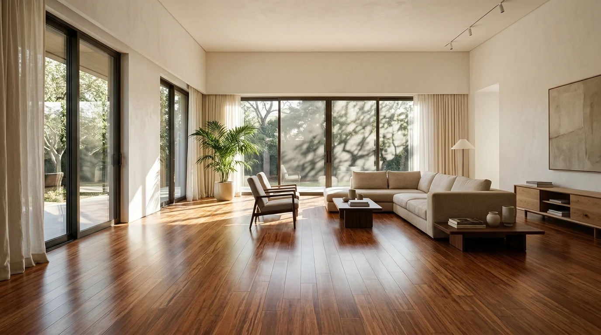
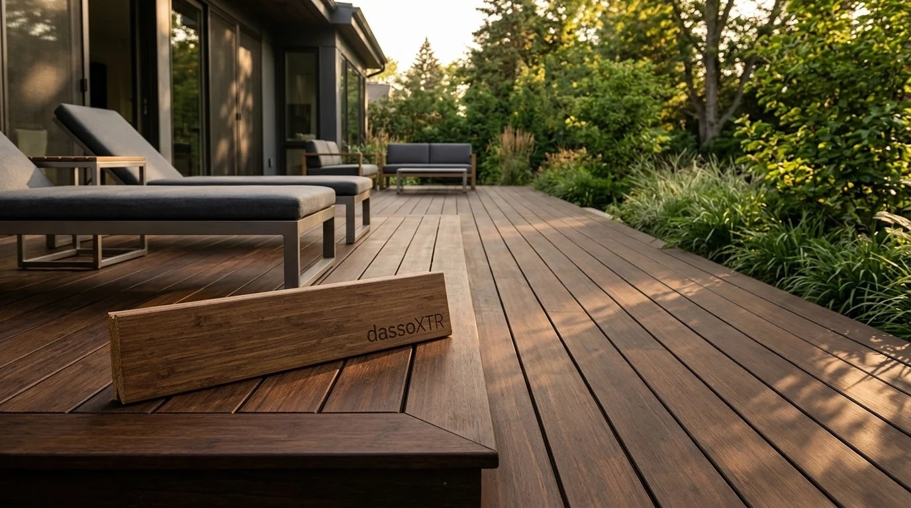

Dasso produces some of the densest, hardest bamboo building materials on the market, making its interior flooring and exterior dassoXTR decking strong contenders against domestic oak, tropical Ipe, and capped composites. Founded in Hangzhou in 1993, Dasso Group controls its own Moso bamboo forests and operates specialized milling facilities alongside distribution hubs in the United States and Europe. Buyers looking for high dent resistance, Class A fire ratings, and genuine organic grain will find high mechanical value here, provided they respect strict moisture acclimation rules indoors and accept natural UV graying—or commit to periodic oiling—outdoors.

## Quick Verdict and Key Specifications

Dasso is worth buying if you want exotic hardwood density without paying Brazilian Ipe prices or settling for plastic-looking composite boards. Its interior strand-woven planks shrug off heavy dog claws and dropped kitchenware, while its exterior fused decking solves the rot and splinter problems that ruined first-generation outdoor bamboo two decades ago. However, both product lines demand carbide-tipped cutting blades during installation and disciplined moisture management over their service lives.

**Dasso Interior Bamboo Flooring Specifications:**
- **Core Construction:** Solid strand-woven bamboo or multi-ply engineered strand-woven bamboo
- **Average Density:** 1,100 to 1,200 kg/m³ (68 to 75 lb/ft³)
- **Janka Hardness:** 2,800 to 3,200+ lbf (more than double red oak at 1,290 lbf)
- **Plank Dimensions:** Typically 14 mm (9/16 in) thickness, 125 to 142 mm width, 1,850 mm length
- **Surface Coating:** Multi-layer UV-cured polyurethane with aluminum oxide wear particles
- **Emissions Compliance:** CARB Phase 2 and TSCA Title VI certified (E0/E1 low-VOC adhesive systems)
- **Material Cost:** $4.50 to $7.50 per square foot
- **Residential Warranty:** 25-year structural and finish coverage

**Dasso Exterior Decking (dassoXTR) Specifications:**
- **Core Construction:** Thermo-treated, phenolic-resin-saturated fused Moso bamboo
- **Average Density:** 1,150 to 1,200 kg/m³
- **Janka Hardness:** Over 3,000 lbf
- **Fire Rating:** Class A flame spread rating under ASTM E84 (Flame Spread Index under 25)
- **Biological Durability:** Class 1 rating under EN 350 for fungal and termite resistance
- **Board Dimensions:** 18 mm or 20 mm thickness, 137 mm (5.4 in) or 178 mm (7 in) width, 1,850 mm (6 ft) length
- **Edge and End Profile:** Side-grooved for hidden fasteners; end-matched tongue-and-groove butt joints
- **Material Cost:** $6.50 to $9.50 per square foot
- **Residential Warranty:** 20- to 25-year limited warranty against rot, decay, and delamination

## Inside Dasso’s Manufacturing Process

Standard horizontal or vertical bamboo flooring glues flat strips together, leaving a relatively soft surface that dents under high heels. Dasso bypasses that limitation through a high-pressure strand-weaving and thermal-modification process designed specifically for structural stability.

Manufacturers harvest mature Moso bamboo stalks at four to six years of age, split them into fibrous strips, and shred those strips into coarse bundles. For exterior dassoXTR boards, those fiber bundles undergo high-heat caramelization at roughly 200°C (392°F). That thermal treatment cooks out natural sugars and starches inside the plant cells, removing the primary food source that attracts mold, decay fungi, and subterranean termites.

After thermal modification, the dried fibers are saturated in exterior-grade phenolic resin and compressed in hydraulic molds under more than 2,500 tons of pressure. The resulting billet is roughly twice as dense as white oak, cured in kilns to stabilize internal stresses, and milled with precision carbide tooling. Because the fibers run longitudinally in an interwoven matrix rather than stacked flat layers, the finished planks resist splitting along glue lines.

## Interior Bamboo Flooring Performance

Dasso’s interior flooring lineup—often distributed under the dasso.HOME banner or supplied to regional architectural dealers—performs best in busy living rooms, hallways, and commercial spaces where surface abrasion destroys softer woods.

### Hardness and Dent Resistance

With Janka ratings routinely testing above 2,800 lbf, Dasso strand-woven planks resist dents far better than solid maple, hickory, or white oak. Large dogs running across hallways rarely leave deep indentations, and rolling office chairs cause minimal compression marks. The factory-applied aluminum oxide finish handles grit and daily foot traffic well, though dark-stained espresso finishes will still show fine surface micro-scratches in direct sunlight if grit is not swept regularly.

### Installation and Subfloor Rules

Dasso produces both tongue-and-groove planks (suitable for glue-down or nail-down installation) and click-lock floating profiles. Because strand-woven bamboo is exceptionally dense, nail-down installations require 18-gauge or 20-gauge pneumatic cleat nailers rather than standard 16-gauge hardwood staplers, which can crack the tongue or fail to penetrate cleanly.

Subfloor flatness is non-negotiable. Installers must level concrete slabs or plywood subfloors to within 3/16 inch over a 10-foot radius. Planks also require a minimum 72-hour to 7-day acclimation period inside the climate-controlled job site before installation begins, with a 1/2-inch expansion gap left around all perimeter walls and vertical obstructions.

### Indoor Air Quality and Finishes

Early imported bamboo flooring earned a poor reputation for off-gassing urea-formaldehyde adhesives. Dasso avoids that issue by using low-emission phenolic and MDI resin binders that meet CARB Phase 2, TSCA Title VI, and European E1/E0 air quality standards. Once unboxed and installed, the planks carry virtually no chemical odor, making them suitable for bedrooms, nurseries, and tight-envelope modern homes.

## Exterior dassoXTR Decking Performance

Exterior bamboo failed in the early 2000s because untreated starch swelled in rain and rotted within three winters. Dasso solved that failure mode with its patented dassoXTR fused bamboo process, creating an outdoor board that behaves much like dense tropical hardwood.

### Fire Rating and Structural Density

One of Dasso’s biggest technical advantages is its Class A fire rating under ASTM E84 testing, achieved without topical fire-retardant sprays that wash away over time. Homeowners building in Wildland-Urban Interface (WUI) zones across California, Colorado, and the Pacific Northwest can specify dassoXTR to meet strict municipal fire codes where standard cedar or low-grade composites fail inspection. Its 1,150 kg/m³ density also gives the deck a solid, quiet underfoot feel with zero hollow bounce.

### End-Matched Joist Installation

Unlike conventional 12-foot or 16-foot composite boards, dassoXTR planks ship in uniform 6-foot (1,850 mm) lengths machined with tongue-and-groove ends. Because the ends lock together structurally, butt joints do not need to land directly over a framing joist. Carpenters can run continuous courses across 16-inch on-center joists with less than 5 percent off-cut waste, while 6-foot boards fit easily inside standard cargo vans and narrow backyard access paths.

### Weathering and Oil Maintenance

dassoXTR ships factory-coated with a penetrating exterior oil (typically Woca or a comparable UV-inhibiting oil) in two core colorways: dark Fused Espresso and warm Classic Cognac. Under direct sun and rain, the surface behaves like teak or Ipe. If you leave the boards unmaintained, UV rays will gradually bleach the dark brown pigment into a uniform silver-gray patina within 6 to 12 months without harming the structural integrity of the board. If you want to keep the rich dark brown color, plan on cleaning the deck and rolling on a fresh coat of penetrating decking oil once every 12 to 18 months.

## Cost Breakdown: Dasso vs. Alternatives

Dasso sits in the upper-middle pricing tier—cheaper than top-grade tropical hardwoods and premium PVC decking, yet noticeably more expensive than entry-level vinyl plank or domestic pine.

- **Dasso Interior Strand-Woven Flooring ($4.50–$7.50/sq ft material):** Costs roughly 15 to 25 percent less than wide-plank European white oak ($6.50–$10.00/sq ft) while offering double the dent resistance. Professional installation adds $3.00 to $5.00 per square foot depending on glue-down or floating subfloor prep.
- **dassoXTR Exterior Decking ($6.50–$9.50/sq ft material):** Undercuts FSC-certified Brazilian Ipe ($10.00–$16.00/sq ft) by 30 to 40 percent and aligns closely with capped polymer and mineral-based composites like TimberTech Azek or Trex Transcend ($7.00–$11.00/sq ft). Hidden stainless-steel clip fasteners add roughly $1.00 to $1.50 per square foot to the material bill.

## Where Dasso Falls Short

No flooring or decking material is maintenance-free, and Dasso presents four practical drawbacks that buyers should factor into their project budgets before ordering pallets.

- **Hard on Cutting Tools:** The extreme fiber density and phenolic resin content dull standard steel saw blades within a few dozen cuts. Contractors must use high-tooth-count carbide-tipped miter blades and pre-drill any face-screw locations near board ends to prevent micro-splitting.
- **Strict Indoor Humidity Limits:** Interior bamboo expands and contracts across its width when indoor relative humidity swings outside the 35 to 55 percent range. Homes in arid winter climates or unconditioned summer cottages require whole-home humidifiers or dehumidifiers to prevent seasonal gaps or slight edge cupping.
- **Exterior Color Fade Without Oiling:** Buyers expecting the zero-maintenance color retention of capped PVC composite boards will be disappointed if they ignore annual oiling. Left untreated, dassoXTR turns silver-gray just like natural hardwood.
- **High Freight Weight:** At roughly 3.5 to 4.2 pounds per square foot, a 600-square-foot order weighs over a ton. Residential curbside liftgate shipping costs significantly more than lightweight luxury vinyl or cellular PVC planks.

## Buying Decision Summary

Choose Dasso interior bamboo flooring if your household includes large pets, heavy foot traffic, and active kids, and you maintain steady indoor climate control year-round. Choose dassoXTR exterior decking if you want the authentic warmth, underfoot rigidity, and Class A fire safety of tropical hardwood without paying Ipe prices—and you either appreciate a weathered silver patina or do not mind spending one weekend a year re-oiling the surface. Skip Dasso if you want a completely waterproof basement floor, live in an unconditioned cabin with wild humidity swings, or refuse to perform any periodic outdoor surface maintenance.