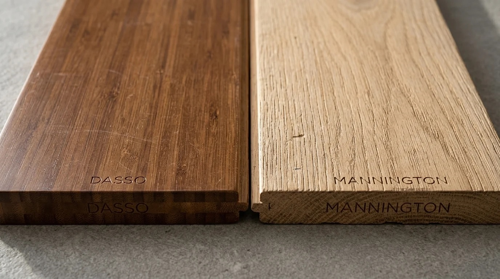
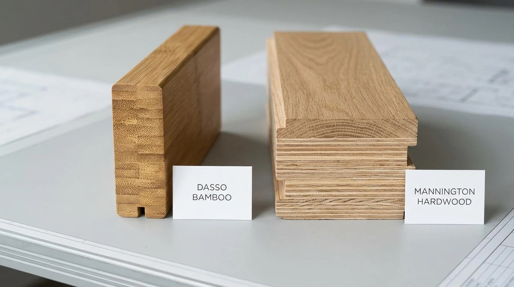

Showroom samples lie by omission. Every plank looks crisp under overhead store lights, freshly milled and untouched by grit, pet nails, sliding dining chairs, or ten cycles of winter furnace air. The real divide between Dasso bamboo and Mannington hardwood shows up around year seven to year ten, long after the installation crew has packed up and the floor has absorbed a decade of ordinary household abuse.

After ten years of residential wear, **Dasso strand-woven bamboo holds a clear lead in dent resistance and structural density, while Mannington engineered hardwood hides fine surface scratches more gracefully and ages with a softer, more traditional patina.** Both floors can easily pass the ten-year mark without needing replacement, yet they show their mileage in completely different ways. Understanding those wear patterns upfront saves you from buying the wrong surface for how your household actually lives.

## Surface Scratches and Dent Resistance at Year Ten

Most homeowners lump scratches and dents together, but flooring engineers treat them as two separate battles. Dents happen in the core material beneath the finish. Scratches happen inside the top protective coating. Over ten years, Dasso and Mannington win opposite halves of that fight.

### Janka Hardness vs. Real Impact

Dasso built its reputation on high-density strand-woven and fused bamboo, compressing shredded Moso bamboo fibers under intense heat and pressure until the finished board reaches a density of roughly 1,150 to 1,200 kilograms per cubic meter. On the Janka hardness scale, quality strand-woven bamboo routinely scores above 3,000 pounds-force and often pushes past 4,000 pounds-force, while Dasso's fused bamboo lines test at 80 to 100 Newtons per square millimeter on the Brinell scale.

Compare that against the wood species Mannington uses across its engineered hardwood collections. Northern red oak sits around 1,290 pounds-force on the Janka scale, white oak lands near 1,360, hard maple reaches 1,450, and hickory tops out around 1,820. Even hickory—one of the toughest domestic hardwoods—gives way under concentrated point loads far sooner than compressed strand bamboo.

In a lived-in home, that density gap shows up right where you expect it: beneath kitchen islands where cast-iron skillets slip, under heavy dining chairs without felt pads, and along hallways walked in hard heels. At year ten, a Mannington oak or maple floor almost always carries shallow dimples in high-traffic zones. A Dasso strand-woven plank takes the same dropped pan and usually shows nothing more than a faint mark in the topcoat.

### How Factory Finishes Age

Harder wood does not automatically mean a scratch-proof floor. Any urethane or aluminum oxide coating can still be scored by tracked-in quartz sand, gravel wedged in boot treads, or untrimmed dog claws.

Mannington leans heavily on its ScratchResist aluminum oxide finish across its engineered hardwood lines, pairing matte or low-luster coatings with wire-brushed or hand-sculpted surface textures. That texture matters more than most buyers realize. When a dog scrambles for a ball on a wire-brushed Mannington white oak plank, fine white scratch lines tuck into the open wood grain and brushed valleys, making them hard to spot from standing height.

Dasso's interior strand-woven planks typically feature smoother, tighter fiber surfaces. Because compressed bamboo lacks the wide open pores of oak, light scuffs in the finish catch angled afternoon sunlight more readily on dark-stained or smooth boards. Choosing a matte finish and mid-tone color on Dasso minimizes that effect, though Mannington's textured oak still camouflages everyday micro-scratches slightly better over a ten-year stretch.

## Moisture, Humidity, and Seasonal Movement

Ten years means ten dry winters with the heat running and ten humid summers with windows opening and closing. Dimensional stability determines whether your floor stays tight and flat or develops creaks, winter gaps, and hairline surface cracks.

### Dry Winters and Humid Summers

Mannington manufactures primarily multi-ply engineered hardwood, available in thicknesses ranging from 3/8 inch up to 5/8 inch and plank widths stretching from 5 inches to 9.5 inches. Cross-layered plywood cores counteract natural wood movement much better than traditional 3/4-inch solid oak planks, which is why Mannington backs its hardwood with a limited lifetime structural warranty against buckling, warping, twisting, or ply separation under normal indoor conditions.

Even so, real wood veneers still react to indoor air that gets too dry. Mannington's warranty explicitly notes that extreme humidity swings can cause checking—fine hairline splits along the wood grain—and excludes that damage when homes lack climate control. Keeping indoor relative humidity between 35 and 55 percent is non-negotiable if you want wide-plank Mannington oak to stay tight through year ten.

Dasso's compressed bamboo products behave differently because the original cellular structure of the grass has been shredded, infused with resin, and fused under extreme pressure. In Dasso's fused bamboo lines, sugars and starches are extracted and replaced with phenolic resin, dropping width swelling rates to around 0.6 percent and earning Durability Class 1 ratings. Standard interior strand-woven bamboo still expands and contracts with seasonal moisture shifts—and needs proper acclimation before installation—yet well-milled high-density bamboo planks resist cupping and warping remarkably well once the home's humidity stays steady.

### Kitchen Spills and Pet Accidents

Neither floor is waterproof, and treating either one like vinyl will shorten its lifespan. Wet mopping, slow dishwasher leaks, or ignored pet puddles eventually find seams in both materials.

That said, short-term spills tell a slightly different story. Dasso's ultra-dense fiber matrix slows down liquid absorption compared to porous red oak, giving you a slightly wider window to grab a towel before moisture darkens an edge joint. On Mannington engineered hardwood, standing water left overnight near a refrigerator line can swell the top veneer edge or darken the oak tannins permanently. Wipe up spills promptly on both floors, keep mats at exterior doors and kitchen sinks, and neither surface will suffer moisture failure inside ten years.

## UV Fading, Patina, and Color Shift Over a Decade

Walk into any home with ten-year-old natural floors and pull back the living room area rug. You will see a shadow line on almost every organic flooring material, because ultraviolet light gradually alters natural pigments.

Bamboo shifts tone noticeably during its first two to three years of direct sun exposure. Natural blonde bamboo tends to warm into a deeper golden amber, while darker carbonized bamboo often lightens slightly where afternoon sun hits through south-facing windows. Once that initial shift settles, the color stabilizes nicely, though moving rugs every six to twelve months early on prevents stark tan lines.

Mannington's hardwood lines react according to species and stain. Natural white oak mellows gently toward a warmer honey tone, while darker espresso stains or American cherry veneers show more dramatic contrast under direct UV rays. Mannington's warranty excludes fading from sunlight, just as bamboo warranties do. Low-E window glass, sheer curtains during peak afternoon sun, and periodic rug rotation keep both floors looking even across a decade.

## Refinishing and Repair After Ten Years

Ten years is the exact point when many homeowners look at their living room floor and ask whether it needs a full sand-and-refinish or just a light refresh. How you answer that question depends entirely on board construction.

### Sanding Limits and Wear Layers

With Mannington engineered hardwood, refinishing depends on the thickness of the sliced or rotary-peeled wood wear layer on top of the plywood core. Thinner 3/8-inch economy lines with rotary-peeled faces generally cannot be sanded down to bare wood at all; you can only abrade the finish and recoat. Thicker 1/2-inch, 9/16-inch, and 5/8-inch Mannington collections with thicker sawn veneers carry a limited two-time sanding warranty, meaning a skilled contractor can sand and restain them once or twice over the life of the floor.

Solid strand-woven bamboo planks are compressed bamboo all the way down to the tongue and groove, allowing two to four full sandings over a 25- to 50-year lifespan. Engineered strand-woven bamboo with a 3- to 4-millimeter wear layer can usually handle one or two careful sandings. There is a practical catch, though: strand-woven bamboo is so dense that it chews through standard sanding belts quickly, and contractors who rarely work with bamboo sometimes leave swirl marks if they rush the grit progression. On the bright side, because strand bamboo resists deep dents so well, most homeowners never need a full sanding at year ten—a simple screen-and-recoat brings back the sheen without removing material.

### Spot Repairs and Board Replacement

Accidents happen over ten years. A dropped sledgehammer during a remodel or a gouged board from a broken appliance wheel requires surgical repair.

Replacing a single damaged plank is straightforward on glue-down or nailed installations of either brand, provided you saved one unopened carton from the original batch. Color matching is actually harder ten years later on Mannington's heavily stained or hand-scraped collections if you failed to keep spare boards, because dye lots and wood grain patterns change across production runs. Dasso's consistent strand grain is slightly easier to blend visually when swapping a single board, though UV aging still means a brand-new spare plank may look slightly fresher until it catches up in sunlight.

## Ten-Year Maintenance Effort and Total Cost

Day-to-day upkeep looks nearly identical for both floors. Dry microfiber dust mopping, vacuuming with the beater bar turned off, and occasional damp cleaning with a pH-neutral wood floor cleaner keep grit from acting like sandpaper underfoot. Avoid steam mops, oil soaps, and wax polishes on both Dasso aluminum-oxide interior finishes and Mannington's ScratchResist coating, as chemical residues dull the sheen and complicate future recoating.

Where the ten-year math diverges is upkeep frequency and warranty coverage. Mannington offers 25- to 50-year residential finish warranties across most collections—and lifetime finish coverage on select lines—alongside FloorScore certification and CARB Phase 2 compliance for indoor air quality. Dasso backs its fused bamboo lines with 25-year residential and commercial structural warranties, and quality interior strand-woven bamboo routinely delivers a 25- to 50-year service life.

Upfront, Dasso strand-woven bamboo typically lands in the mid-to-upper residential bracket, often undercutting Mannington's wider, thicker European white oak collections by one to three dollars per square foot on materials alone. Factor in ten years of wear: if you have large dogs, active kids, or heavy furniture, Dasso saves you from an early refinishing bill that can easily run three to five dollars per square foot. If you prefer classic wide-plank oak aesthetics and live in a lower-impact household, Mannington's resale familiarity and forgiving wire-brushed grain earn back that upfront premium when it comes time to sell.

## Frequently Asked Questions

### Which Floor Lasts Longer Overall?

Both floors routinely last 25 to 50 years with steady indoor humidity and basic care. Solid strand-woven Dasso bamboo holds a slight structural durability edge in heavy-traffic homes because its extreme density resists crushing and deep gouges over decades.

### Does Bamboo Scratch Easier Than Oak?

No—both rely on their aluminum oxide topcoats for scratch defense, not just the core beneath. However, smooth dark bamboo shows light surface scuffs more visibly in bright sunlight than Mannington's wire-brushed oak, which hides fine marks inside its open grain.

### Can You Refinish Both Floors?

Yes, depending on plank construction. Solid Dasso strand-woven bamboo can be sanded multiple times by an experienced pro, while Mannington's thicker engineered hardwood collections carry a limited two-time sanding warranty. Thin rotary-peeled engineered planks from any brand should only be buffed and recoated.

### Which Handles Big Dogs Better?

Dasso strand-woven bamboo wins on dent prevention from heavy paws and claws, while Mannington's matte wire-brushed hickory or white oak hides shallow claw marks better. Pairing a matte finish with regular nail trimming matters more than the brand name alone.

Choosing between Dasso bamboo and Mannington hardwood after seeing how both behave at year ten comes down to which kind of wear bothers you less. If deep dents from dropped objects and heavy furniture drive you crazy, Dasso's compressed strand density keeps the surface remarkably flat year after year. If you want traditional wide-plank wood character that camouflages minor scuffs and speaks immediately to future homebuyers, Mannington's engineered hardwood remains a dependable long-term investment.