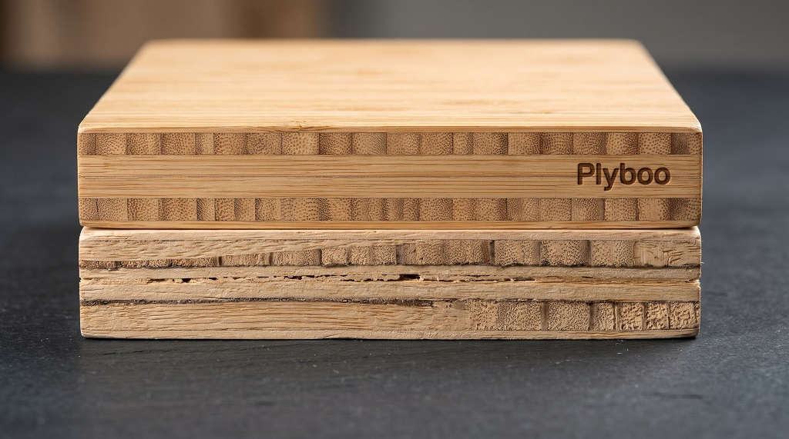
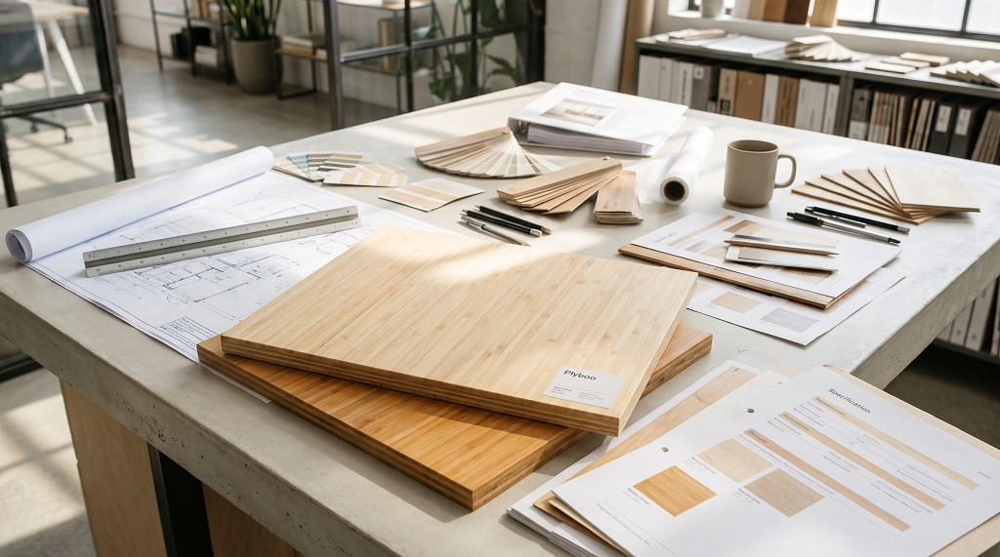
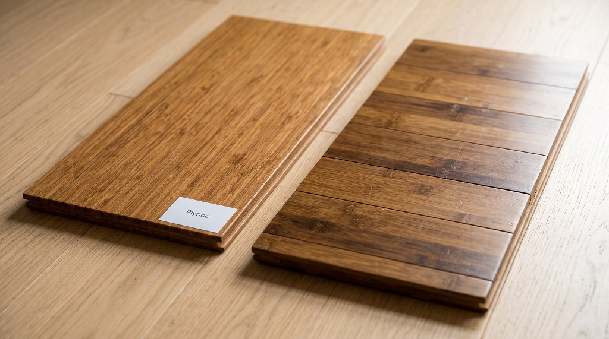

When an architect specs a 3/4-inch sheet of Plyboo bamboo plywood or a homeowner prices out Plyboo flooring against big-box alternatives, the sticker shock hits fast. Branded 4-by-8 architectural sheets routinely land between $385 and $420 at U.S. specialty suppliers, while generic 3-ply bamboo sheets from discount importers sell for $175 to $220. On the flooring side, Plyboo Direct prices prefinished flat- and edge-grain planks at $6.25 per square foot and strand-woven lines at $7.25 per square foot, whereas entry-level bamboo at national home centers starts between $1.78 and $3.50 per square foot.

Both products come from Moso bamboo. Both get milled into strips, glued under heat and pressure, and sanded smooth. So what does that extra 50% to 100% actually buy?

Part of the markup pays for three decades of brand equity, U.S. warehousing, and architectural sales reps. The rest pays for four measurable manufacturing and compliance differences: soy-based adhesive chemistry, culm maturity at harvest, kiln-dried core balance, and audited commercial paperwork. Knowing which of those factors matter on your specific job keeps you from overpaying on hidden cabinet boxes—and from getting burned on a warped floor or rejected submittal.

## Where the Price Gap Actually Comes From

Smith & Fong Co., founded in San Francisco in 1989, launched the Plyboo brand in 1993 as the first U.S. company to bring bamboo flooring into North America, followed by bamboo plywood in 1996. Because the company built its business around commercial architects and custom millwork shops rather than retail clearance aisles, its cost structure looks nothing like a direct-import warehouse.

Every sheet of branded architectural bamboo carries overhead that never appears on a factory invoice. That includes regional distributor margins, stocked U.S. inventory across more than 50 plywood configurations, custom sample programs, and dedicated technical support teams who answer specification questions. When you buy a $180 generic sheet online or a $2.25-per-square-foot closeout plank, you strip away that distribution layer immediately.

Still, distribution overhead only explains part of the spread. Two mills sitting ten miles apart in China's Moso bamboo belt can produce panels that look identical in a listing photo while behaving like completely different materials once a saw blade hits them.

## Four Material Differences You Can Measure

### Adhesive Chemistry and Air Quality

The single biggest invisible difference between Plyboo and low-cost bamboo sits in the glue line. Standard budget bamboo plywood and bargain flooring still rely heavily on urea-formaldehyde or lower-grade melamine resins because they cure fast and keep factory press times short. Even when those boards technically clear federal minimums, off-gassing spikes in warm, tightly sealed interiors, and weak glue bonds can creep or separate under seasonal moisture swings.

Plyboo developed its proprietary SoyBond system with Ashland Inc. using soy-based adhesive technology formulated with no added urea-formaldehyde. Under ASTM D6007 chamber testing, Plyboo's flat- and edge-grain lines measure at 0.006 parts per million for formaldehyde emissions, passing California Section 01350 indoor air quality standards and earning both SCS Indoor Advantage Gold and FloorScore certifications. For nurseries, schools, healthcare spaces, or clients sensitive to indoor VOCs, verified low-emission chemistry is not marketing fluff.

### Harvest Maturity and Strip Grading

Moso bamboo reaches full structural density at roughly five to six years of growth. Harvesting mature culms costs more because growers must tag stalks by age, manage groves selectively, and wait longer between cuts. Budget suppliers chasing aggressive retail price points frequently blend in three-year-old stalks—or mix softer inner culm wall strips with denser outer fibers—to boost yield per hectare.

You feel that shortcut immediately under a heavy dining chair or dropped skillet. According to ASTM D1037 Janka ball hardness testing, Plyboo's natural flat-grain bamboo averages 1,900 pounds-force and natural edge-grain averages 1,700 pounds-force. Carbonizing bamboo with steam to create an amber color caramelizes the natural sugars and softens the fibers, dropping Plyboo's averages to 1,400 lbf for flat-grain amber and 1,300 lbf for edge-grain amber, while compressed PlybooStrand climbs to 3,000 lbf—roughly twice the hardness of red oak.

When a discount manufacturer carbonizes immature three-year-old bamboo, hardness plunges well below oak. Floors dent under ordinary heels, and cabinet edges crush when bumped with a pot. Color sorting tells a similar story: high-end mills reject mismatched strips before pressing so adjacent sheets match across a 20-foot kitchen wall, while budget bundles pack wide shade swings into the same pallet.

### Core Construction and Sheet Flatness

Pick up a 3/4-inch 4-by-8 sheet of 3-ply Plyboo architectural plywood and you will feel roughly 90 pounds of tightly packed, cross-laminated bamboo—and 128 pounds if you move up to a 3/4-inch PlybooStrand sheet. The face layers, center core, and glue spread are balanced symmetrically so internal stresses cancel out when you rip tall cabinet doors or route deep dadoes on a CNC bed.

Budget bamboo panels often look clean on the face while hiding trouble inside the center ply. To trim manufacturing cost, lower-tier plants leave wider tolerances between interior strips, allow small edge gaps that get patched with colored putty, or press uneven ply thicknesses. The sheet looks flat stacked on a pallet. Two days after you cut it into 18-inch drawer fronts, bow and twist start showing up, and exposed cut edges reveal dark filler pockets that ruin a clear coat.

### Moisture Control Before Shipping

Bamboo moves far less than many solid hardwoods when dried properly, yet it turns unforgiving if a factory rushes the kiln. Plyboo holds its flat- and edge-grain products to an ASTM D4442 moisture content between 6% and 9%. Under ASTM D1037 dimensional stability testing across a drop from 50% to 20% relative humidity, Plyboo edge-grain material registers just -0.02% linear expansion parallel to the grain and -0.07% perpendicular, while flat-grain measures -0.04% parallel and -0.13% perpendicular.

Cutting kiln time saves a factory fuel and lets containers ship faster, which is why bargain bamboo frequently arrives at 11% to 13% moisture content. Install those planks in a dry winter climate with forced-air heat running at 30% humidity, and the planks shrink, open hairline seams, or cup along the edges. Re-milling a failed floor or replacing bowed cabinet doors wipes out every dollar saved at checkout.

## Paperwork, Audits, and Commercial Risk

On residential remodels, most buyers never ask for a submittal packet. On commercial jobs, missing paperwork stops payment dead in its tracks.

Smith & Fong maintains FSC 100% chain-of-custody options, published Health Product Declarations, Environmental Product Declarations, and third-party emissions certificates that feed directly into LEED credits for rapidly renewable and low-emitting materials. Its flooring carries an ASTM E648 Class 1 critical radiant flux fire rating, and its architectural plywood can be special-ordered to meet Class B flame-spread requirements.

Budget brands routinely print "eco-friendly" and "sustainable bamboo" across their boxes without holding active third-party audits. If a building inspector asks for a current ASTM E648 test report or a LEED reviewer demands chain-of-custody documentation tied to the exact batch number on the invoice, a generic distributor rarely has anything verifiable to send back. Architects specify Plyboo partly because it removes professional liability from their desk.

## When Paying for Plyboo Makes Financial Sense

### Commercial Specs and Green Audits

Any institutional or commercial build—corporate offices, universities, boutique hotels, libraries, or retail flagships—justifies the Plyboo premium almost automatically. The cost of delaying occupancy over a failed fire-rating submittal or losing a LEED point dwarfs the difference between $190 and $400 per sheet. You are buying predictability, repeatable batch matching across phased deliveries, and documentation that passes review on the first try.

### Exposed Millwork and Busy Floors

Clear-finished kitchen cabinets, reception desks, floating stair treads, and high-traffic living areas expose every flaw in raw material quality. Plyboo's factory prefinished flat- and edge-grain floors test between 20,000 and 28,000 Taber abrasion wear-through cycles, and its 3,000-lbf strand flooring shrugs off heavy foot traffic and pets. When your edges stay exposed without edge banding—a signature look of multi-ply bamboo—void-free cores and tight glue lines save hours of shop-floor sanding, filling, and sorting.

## When Budget or Direct-Sourced Bamboo Wins

### Hidden Carcasses and Light-Use Rooms

Paying architectural-brand pricing makes little sense when the bamboo is hidden or lightly stressed. Cabinet interiors, closet shelving, guest bedrooms, painted accent millwork, or short-term rental refreshes do not require published EPDs or 3,000-lbf strand cores. Even high-end cabinet shops routinely mix materials: they buy certified architectural sheets for visible door fronts and end panels, then build interior boxes from lower-cost bamboo or Baltic birch to keep client quotes competitive.

### How to Vet a Non-Brand Supplier

Skipping the Plyboo nameplate does not mean settling for junk. Plenty of reputable direct-to-trade manufacturers and specialized bamboo mills produce tight-tolerance, low-VOC panels and flooring without North American architectural markups—provided you verify specs before placing a deposit. Ask any non-brand supplier for five concrete items before buying:

- **Current emissions test reports:** Request third-party CARB Phase 2, TSCA Title VI, or ASTM D6007 formaldehyde lab results matching the exact adhesive system on your quote, not a five-year-old brochure.
- **Verified moisture content range:** Confirm in writing that panels or planks are kiln-dried to 6%–9% moisture content and packaged with moisture-barrier wrapping for ocean transit.
- **Cut-edge core inspection:** Order a physical corner sample rather than a thin color chip so you can check strip alignment, glue-line thickness, and core density with your own eyes.
- **Harvest age and density numbers:** Ask for the Moso culm maturity (five years minimum) and actual sheet weight—a genuine 3/4-inch 4-by-8 solid 3-ply sheet should sit near 85 to 90 pounds, not feel suspiciously light.
- **Finish and wear testing for flooring:** For prefinished planks, confirm the aluminum-oxide coat count, gloss level, and whether the milling tolerance holds tight tongue-and-groove joints without micro-bevel gaps.

Plyboo earned its reputation by standardizing a material that used to vary wildly from container to container. If your project demands audited green building credentials, dead-flat exposed millwork, or quick U.S. distribution backup, the premium buys real risk reduction rather than just a familiar logo. If you have the time to inspect samples, verify lab reports, and buy from an established factory-direct supplier—or you simply need solid sheets for secondary spaces—you can keep a large chunk of that brand markup in your own budget without sacrificing a straight cut or a durable floor.