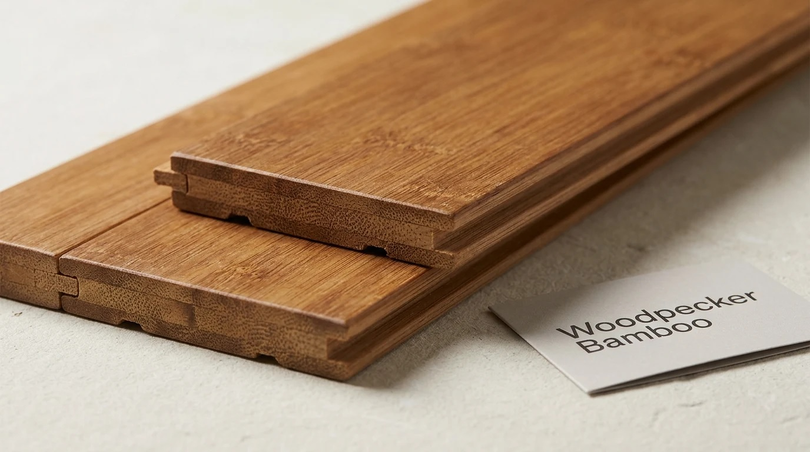
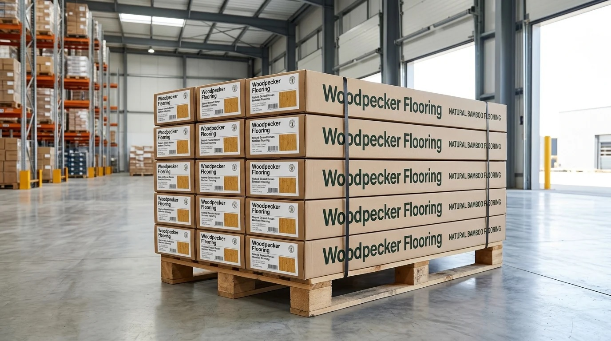

Woodpecker Flooring, a family-run timber and bamboo specialist headquartered in Caerphilly, South Wales, has built a strong reputation across the United Kingdom for architectural wood and bamboo surfaces. Homeowners and interior designers outside Britain frequently ask whether Woodpecker Bamboo Flooring is worth importing to North America, Australia, or other international markets. While the planks offer high structural density, dependable click-lock milling, and refined European matt finishes, cross-border freight charges, import tariffs, and regional warranty exclusions rarely make individual residential imports financially practical.

For buyers living in the UK or Ireland, Woodpecker remains one of the most reliable mid-to-upper-tier bamboo flooring brands available through independent showrooms. For overseas buyers, however, understanding how these boards are built—and how their landed cost compares against local equivalents—prevents costly procurement mistakes.

## What Defines Woodpecker Bamboo Flooring in the UK Market?

Woodpecker Flooring supplies an extensive network of independent flooring retailers and architectural specifiers across Britain. Rather than flooding catalogs with dozens of near-identical SKUs, the company curates focused bamboo collections designed around British residential tastes and building standards.

The core bamboo lineup centers on three signature ranges:

* **Brecon:** A strand-woven bamboo plank collection featuring subtle wire-brushed grain, low-luster matt lacquer, and the brand's Easiloc click-joint profile for straightforward floating installations.
* **Goodrich:** A classic solid strand-woven range available in warm caramel and natural honey tones, engineered to handle high-traffic living rooms, hallways, and light commercial interiors.
* **Chepstow:** An engineered bamboo series tailored for wider plank proportions and patterned parquet layouts, blending a dense bamboo wear surface with a stable multi-ply core.

What immediately separates Woodpecker from older generations of bamboo flooring is surface restraint. Early bamboo floors sold two decades ago often featured glossy coatings and pronounced horizontal knuckle patterns that clashed with traditional interior trim. Woodpecker relies on compressed strand-woven fibers finished with soft-sheen matt lacquers and light surface brushing. From standing height, the boards read closer to contemporary European oak while preserving the distinctive, fine organic veining of natural Moso bamboo.

Responsibly harvested Moso bamboo forms the raw material backbone of these collections. Because Moso bamboo reaches harvest maturity in roughly four to six years without killing the root system, FSC-certified plantations provide rapid regenerative yield compared with slow-growing hardwood forests.

## Construction Quality, Hardness, and Daily Performance

Evaluating any bamboo floor requires looking beneath the topcoat at fiber compression density, milling accuracy, and moisture tolerances. Woodpecker performs well across all three technical benchmarks.

### Strand-Woven Density and Scratch Resistance

Standard horizontal or vertical laminated bamboo floors can dent under heavy furniture or stiletto heels, whereas strand-woven construction changes the mechanical profile entirely. During manufacturing, shredded Moso bamboo fibers are coated in low-emission resin and compressed under extreme hydraulic pressure into dense timber-like blocks before being milled into planks.

This process produces Janka hardness ratings typically measuring between 2,800 and 3,200 lbf (over 13 kN), roughly double the indentation resistance of traditional European oak or North American red oak. In busy family homes with large dogs, rolling dining chairs, and constant foot traffic, the underlying bamboo core resists dents remarkably well.

Surface finish plays an equally important role in daily livability. Woodpecker applies multiple coats of UV-cured matt lacquer over a lightly brushed texture. While no lacquered wood or bamboo surface is immune to sharp grit dragged beneath shoes, a low-sheen brushed finish diffuses overhead light and hides minor surface scuffs far better than semi-gloss coatings.

### Easiloc Milling and Installation Flexibility

Precision milling determines whether a floor lays flat without squeaks or micro-gaps. On click-profile lines such as Brecon, Woodpecker utilizes its Easiloc locking mechanism, allowing planks to angle and snap together cleanly over a quality acoustic underlayment. Floating installations keep subfloor preparation manageable over existing timber boards or level concrete screeds.

For solid tongue-and-groove strand-woven profiles or larger rooms where installers want zero hollow footsteps, full-surface glue-down installation using a flexible silane-modified polymer adhesive delivers rock-solid underfoot acoustics. Installers generally report consistent board thickness and square end-milling across boxes, reducing waste during layout and cutting.

### Humidity Limits and Underfloor Heating

A common misconception among shoppers is treating strand-woven bamboo as completely waterproof. Although compressed bamboo absorbs moisture more slowly than softwood pine or red oak, it remains a natural hygroscopic material that expands and contracts with seasonal humidity swings.

Woodpecker recommends acclimating unopened boxes inside the installation room for at least 48 to 72 hours while maintaining indoor relative humidity between 40% and 60%. Planks perform reliably in kitchens, hallways, and living spaces when spills are wiped promptly, but they are unsuitable for wet rooms, steam showers, or full bathrooms prone to standing water.

When paired with embedded hydronic underfloor heating systems, Woodpecker's engineered and click-lock bamboo planks conduct warmth efficiently, provided the subfloor surface temperature never exceeds 27 degrees Celsius (80 degrees Fahrenheit) and heat is increased gradually during seasonal transitions.

## Calculating the Real Cost of Importing Overseas

On paper, British retail pricing for Woodpecker Bamboo Flooring looks competitive. Depending on the specific collection, plank thickness, and retailer discount, UK street prices typically range between £45 and £65 per square meter—roughly $5.50 to $8.00 per square foot before Value Added Tax adjustments. Once an international buyer attempts to bring those pallets across an ocean, however, ancillary logistics costs reshape the budget.

### UK Retail Price Versus Landed Freight

A standard 80-square-meter (860-square-foot) residential flooring order weighs roughly 900 to 1,100 kilograms once packed onto heat-treated export pallets. Because residential orders fall well short of a full 20-foot shipping container, buyers must ship via less-than-container-load (LCL) ocean freight.

When you tally export crating, UK port drayage, ocean freight, marine cargo insurance, destination terminal handling fees, customs brokerage, and applicable import duties, landed costs routinely jump by 45% to 80% above the original material invoice. A floor that costs $6.50 per square foot in South Wales can easily reach $10.50 to $11.50 per square foot delivered to a driveway in New York, Toronto, or Sydney. At that price point, Woodpecker competes directly against wide-plank European engineered oak already stocked in local showrooms.

### Warranty Exclusions and Spare Plank Risks

Long residential guarantees are a major selling point for Woodpecker inside Britain, with coverage ranging from 25 years up to 100 years on select current lines. However, those warranties apply strictly to flooring purchased through authorized UK or Irish dealers and installed within those jurisdictions.

Importing planks privately across international borders effectively leaves the homeowner without local manufacturer warranty support, since regional representatives cannot conduct on-site moisture inspections overseas. Just as important is long-term repair logistics: if an appliance leaks or a dropped cast-iron skillet gouges three planks two years after installation, air-freighting a single replacement box from Wales can cost more than the flooring itself.

## How Woodpecker Compares to North American Alternatives

Understanding global bamboo supply chains puts the import question into sharper focus. Virtually all architectural-grade strand-woven bamboo flooring—whether sold under British, American, or Australian brand names—is harvested and milled from Moso bamboo plantations in China's Zhejiang and Anhui provinces to each brand's proprietary specifications.

Established North American brands such as Cali Floors, Ambient Bamboo, and Dasso source from the same premier manufacturing hubs, offering comparable Janka hardness ratings, CARB Phase 2 and FloorScore indoor air quality certifications, and precision click-lock or tongue-and-groove profiles right from domestic distribution centers.

Where Woodpecker retains a subtle design advantage is European finish curation. British interior preferences lean heavily toward muted, chalky, low-sheen brushed tones, whereas several mainstream North American bamboo lines favor slightly warmer amber stains or higher gloss levels. Even so, ordering sample boxes from three or four domestic bamboo specialists almost always uncovers a close visual match without transoceanic freight bills.

## Practical Buying Advice Before You Order

Deciding whether Woodpecker Bamboo Flooring belongs in your project comes down to geography and order scale:

* **If you live in the UK or Ireland:** Woodpecker is a standout choice. You gain access to local showroom displays, free sample delivery, vetted installer recommendations, and full manufacturer warranty backing.
* **If you are renovating a home in North America or Australia:** Skip the overseas import. Compare samples from local strand-woven bamboo suppliers that stock inventory domestically, honor regional warranties, and allow you to pick up an extra box locally if future repairs are ever needed.
* **If you are specifying a large commercial project:** Importing only makes financial sense when ordering 500 square meters or more—enough volume to fill a dedicated shipping container, lock in trade export pricing, and include a 10% attic-stock buffer for future maintenance.

By matching your sourcing strategy to local inventory realities, you can achieve the dense durability and clean architectural look of high-grade strand-woven bamboo without paying twice for ocean freight.